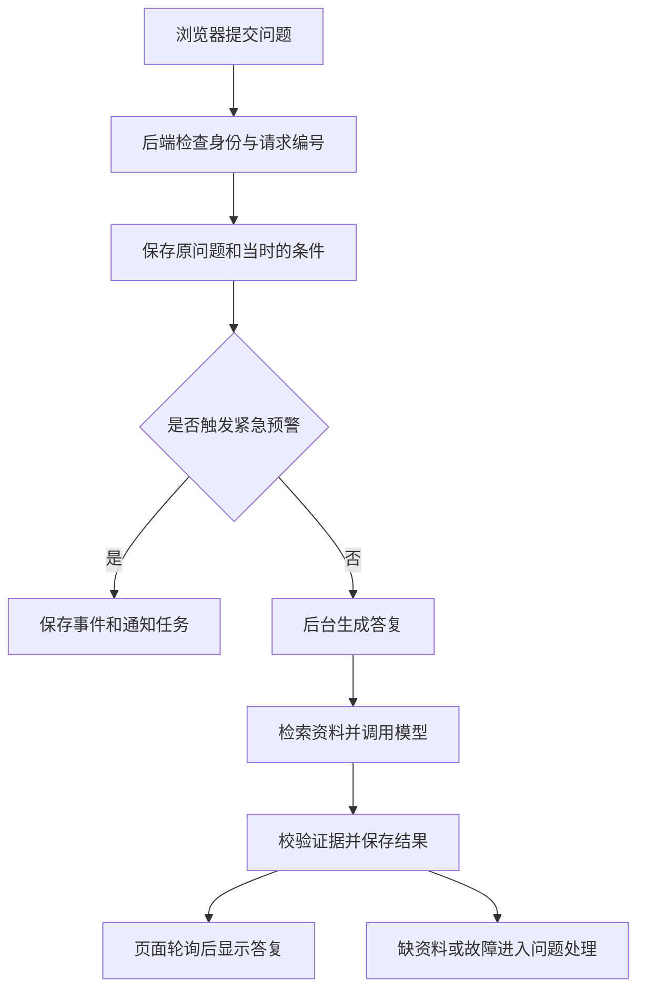

# 管理学院制度问答系统搭建过程与学习实践

更新日期为 2026-11-12。项目持续开发，本文会随实现变化更新。

本文对照的 Git 基线为 `3a0eca2`，同时阅读了当前工作区的未提交实现。新增的语义拆分、证据数字校验、竞赛计算和排名模块属于工作区进展，尚不能仅凭提交记录确认它们的完整验收情况。本文编写时只核对代码与历史记录，没有重新运行全套模型和浏览器测试。

## 1. 先弄清楚要建什么

学院需要学生查询制度，老师维护资料，并处理系统暂时答不了的问题。学生提问后，系统要能找到真实依据、说明适用范围，并给出可以打开的出处。资料缺失时，要留下问题供后续处理。新资料补进来后，要检查旧问题能否解决。

这形成了三个相连的流程。

- 资料进入系统，经过解析、切片、索引，成为可检索的知识库。
- 学生提问，经过条件理解、检索、生成与校验，得到有出处的答复。
- 答不了的问题进入工作台，新资料发布后自动复测并更新处理状态。

本项目用代码组织这些步骤，模型承担其中的理解和答复任务。学习 Agent 应用工程，可以从这个流程入手，再逐步练习模型自主选择工具、根据工具反馈继续执行和停止的能力。

**你的第一项练习**

不用看代码，画出学生、管理员、知识库和模型之间的数据流。说明哪些操作需要调用模型，哪些操作由程序直接完成。画完再对照下一节。

## 2. 工程为什么分成这些部分

| 部分 | 项目中的位置 | 负责的事 |
|---|---|---|
| 用户和管理网页 | `web/src/main.tsx` | 表单、对话、引用弹窗、上传、问题列表 |
| 网页请求封装 | `web/src/api.ts` | 请求、错误提示、前后端类型约定 |
| HTTP 接口 | `backend/app/main.py` | 接收请求、鉴权、调用业务逻辑、返回结果 |
| 数据与迁移 | `models.py`、`db.py`、`backend/migrations` | 数据表、事务、结构升级 |
| 文档解析 | `storage.py` | 文件校验、格式解析、页码与行号、OCR 衔接 |
| 检索与向量 | `retrieval.py`、`embeddings.py` | 切片、BGE 向量、候选排序、出处信息 |
| 问答 | `qa.py` | 条件承接、模型请求、答复校验、范围说明 |
| 业务处理 | `services.py` | 问题归组、历史记录、发布后复测、周报统计 |
| 预警与邮件任务 | `alerts.py` | 预警分流、任务状态、模拟或 SMTP 发送 |
| 启动与部署 | `scripts/start-demo.ps1`、`deploy` | 本机进程管理、容器与服务器配置 |

React 和 TypeScript 负责浏览器界面。FastAPI 负责后端接口，SQLAlchemy 负责访问数据库，Alembic 负责数据库迁移。本机演示用 SQLite，正式部署配置使用 PostgreSQL。DeepSeek 提供云端模型服务，BGE 在本地生成检索向量。

**你的第二项练习**

找到页面里的发送按钮，沿着 `api('/questions', ...)` 找到后端 `submit`，再找到后台生成答复的入口。记下请求字段和返回字段，特别关注 `request_id`、`previous_id`、`business_year` 和问题状态。

## 3. 搭建时先完成最小流程

一开始最重要的是让一条问题从网页走到数据库，再把结果带回页面。



接口会先接受问题，网页随后查询处理结果。这样用户不用在一次长请求里等待全部模型操作。程序保存原问题、当时条件和资料引用，便于后来排查。

最初可以用模拟模型验证流程是否正确，再接真实模型。模拟模式能测试状态和接口，真实服务才能验证实际模型输出、费用、延迟及答复稳定性。

**检查自己是否理解**

如果点一次发送按钮却出现两条问题，你应该先检查请求编号和重复请求处理。如果网页一直显示等待，要检查问题是否已完成、后台是否执行，以及轮询是否取到了结果。

## 4. 知识库是怎样建出来的

### 4.1 上传、解析和发布是不同步骤

接收文件成功，只能说明系统拿到了文件。还要确认正文是否读出来、是否建了向量，以及资料是否进入可检索状态。

项目后来按使用反馈改成普通资料解析成功后自动发布，并自动识别明确的年度。含图资料需要额外检查 OCR 的结果。发布状态可以在 `documents` 表看，文本片段可以在 `chunks` 表看。

文件名中的年份可以帮助识别适用范围，但还要检查原文。当前协作规则要求年度、年级和有效期用于排序和范围说明。学习时以当前 `AGENTS.md` 和检索代码为准，旧记录中严格按年份过滤的做法属于此前阶段。

### 4.2 先按结构拆，再按长度切

PDF 按页提取，Word 按段落和表格行提取，Excel、CSV 按行提取，PPTX 保留幻灯片页码。解析器返回的是一组「来源位置和正文」。

当前 `build_chunks` 的基础切片窗口为 800 字符，步长为 650 字符。因此，同一解析单元内相邻窗口重叠 150 字符。

例如一个单元有 1,500 字符，窗口依次覆盖 1—800、651—1450 和 1301—1500。重叠帮助保留被边界切开的条款。同一个解析单元之外的上下文还需要通过检索和结构处理补齐。

**亲手实验**

在测试里准备一段超过 800 字符的虚构条款，故意把「特殊情况下除外」放在切片边缘。检查片段里能否保留完整规则。再把例外放到下一页，观察结果有什么变化。

### 4.3 每个片段单独生成向量

`index_bge` 把文档标题和片段正文交给 BGE。当前模型标识可以在 `embeddings.py` 核对，每条片段保存自己的 BGE 向量。

提问时，问题也会生成向量。检索器结合关键词、向量相似度、资料结构和适用范围选择候选。BGE 负责查找语义相关内容，最终答案还需要模型和程序校验。

## 5. 为什么“资料已上传”仍可能答不了

项目里的征兵 PPT 是一个完整案例。

1. PPT 成功上传，系统也提取出了多页文字。
2. 第 8 页有年龄、身高、体重和视力标题，但具体数值写在图片里。
3. 早期解析只取文本框，因此候选片段缺少条件。
4. 检查原文件后，先用 LibreOffice 渲染页面，再用 OCR 识别实际画面。
5. OCR 中有比较符号、性别和数字识别错误，需要对照可见图表核对。
6. 核对后的第 8 页内容补进索引，才能支持该问题的回答。

这次排查说明，索引里的文本是否完整需要单独验证。模型再强，也无法可靠回答系统没有提供的条款。

当前工作区还出现了 `rapid_ocr.py` 等后续实现。学习时逐项核对配置、实际使用的 OCR 路径和运行环境，避免把历史工具链说明当成当前唯一实现。

**亲手实验**

选一页包含图片文字的资料，同时记录原生文本和 OCR 文本。核对数字、单位、表头和否定词，说明哪部分能进入问答，哪部分仍需核对。

## 6. 模型怎样接入，怎样避免错误

在 `DeepSeekModel` 中找到模型请求。阅读系统提示词、用户问题、候选证据、返回 JSON 的约定和超时处理。密钥从后端配置读取。

项目的答复规则经历过变化。

| 阶段 | 遇到的问题 | 调整与学习点 |
|---|---|---|
| 直接展示检索原文 | 学生看到大量条款，找不到直接结论 | 让答复先回答问题，再给出处 |
| 模型生成简短答复 | 可能引入证据里没有的内容 | 增加来源、原文和数字校验 |
| 逐字摘录与行号选择 | 措辞或长度校验过严，正确内容也可能被挡住 | 核对程序取证方式和答复预算 |
| 当前工作区的规则 | 允许保持原意的转述，答复整合到 500 字符以内 | 保留真实出处，重点检查数值、单位、方向、否定和例外 |

读当前 `verified_excerpts`、`policy_answer_text` 和 `evidence_numbers.py`，理解哪些检查在程序里执行。原文 ID 存在，只证明出处存在。你还要检查所选条款是否回答问题，以及答案是否忠实表达条件。

**亲手实验**

构造四种返回结果，分别是不存在的出处、真实出处但问题无关、数字改变、原意不变的同义转述。逐一观察后端应该接受、修正还是拒绝。

## 7. 从“换个问法”学会问题理解

“入伍的条件是啥”和“参军要满足哪些要求”可能表达同一意图。早期版本通过口语归一和候选排序修复这些例子。当前工作区又增加了 `question_planning.py`，用于校验模型对问题片段的分组。

模型可以判断多个片段是否属于同一事项。程序要限制它只组合原输入，避免丢掉用户的条件或新增事实。阅读 `grouped_questions`，观察索引范围、顺序、重复和覆盖检查。

竞赛和排名问题需要更进一步。当前 `competition.py`、`competition_catalog.py` 和 `ranking.py` 用于处理专项规则。需要计算时，应让程序从制度中取数并计算，模型再组织语言。

**练习题**

- “那 24 年呢”依赖前题的哪些信息？
- “国家励志奖学金需要哪些材料，交给谁”应怎样保留同一事项的多个条件？
- “省级三等奖、三个人、第二顺位加几分”需要补齐哪些制度维度？
- “入伍后怎么复学”与“入伍需要什么条件”分别应召回什么？

每题都要准备一个能区分意思的相邻问题，检查修复是否误伤它。

## 8. 自动处理旧问题怎样实现

`Question` 保存一次提问，`Issue` 保存需要处理的事项。相同事项可以归为一组，组内仍保留每次提问、人员快照和上下文。

资料发布后，`resolve_issues_after_publish` 查找旧问题，并由 `retest_issue` 按每条原条件复测。系统记录引用和结果，通过后更新状态。这里要学会事务、重试和并发更新。

例如复测正在运行时，管理员停用了资料，或者另一条提问加入了该组，程序不能拿先前的结果覆盖新状态。可以在当前代码里找 `revision`、发布状态检查和条件更新语句。

自动任务还需要运行保障。检查它由 API 进程内后台任务、独立工作进程还是持久队列执行，再确认进程中断后的补跑方式。后续正式验收时应实际测试这一点。

## 9. 最有价值的一次排障

项目曾出现“新代码测过，用户网页依然失败”。

直接调用 Python 函数时使用了新代码，但浏览器请求仍进入一个残留的旧后端。重新打开网页只启动了新前端，旧后端还占着 8000 端口。

定位时核对了三类证据。

- 数据库中该次真实提问的时间、上下文和保存结果。
- 8000、5173 端口对应的进程，以及后端启动时间。
- 同一个 `localhost:5173` 网站中的实际提问与页面结果。

后来在启动脚本加了端口冲突检查、后端就绪检查和子进程清理。对你而言，这一段应亲手复现。学会确认“我测的代码”和“用户访问的服务”是不是同一个版本。

可以先阅读启动脚本，不必为了练习强行制造残留进程。

## 10. 按这个顺序学习

| 次序 | 要亲手完成的事 | 完成标准 |
|---|---|---|
| 1 | 按 [演示操作手册](demo.md) 启动网站 | 能解释前端、API、工作进程各做什么 |
| 2 | 跟踪一条提问 | 能在 Network 与数据库找到同一次请求 |
| 3 | 上传一份虚构的小文档 | 能找到片段、出处和向量字段 |
| 4 | 调试一次召回 | 能解释正确片段为什么进入或落出候选 |
| 5 | 复现一次答案错误 | 区分解析、检索、生成和校验的问题 |
| 6 | 加一项自己的改动和测试 | 有提交记录、原例、变体和正常对照例 |
| 7 | 跑一次实际网页验证 | 记录输入、返回结果、模式和环境 |

在项目的 `backend` 目录，可以运行局部测试。

```powershell
.\.venv\Scripts\python.exe -m pytest -q tests/test_knowledge.py tests/test_workflow.py
```

在项目的 `web` 目录，可以验证类型和构建。

```powershell
npm run typecheck
npm run build
```

测试可能通过环境配置、临时数据库和模拟模型隔离依赖，先阅读 `tests/conftest.py`。新工作区的专项测试可以从 `test_answer_policy.py`、`test_semantic_planning.py` 和 `test_question_grouping.py` 继续读。

## 11. 每次实验怎么记

复制下面的模板，每次只研究一个明确的问题。

```text
代码版本或工作区日期
使用的文件、页面和模型模式
原问题与期望结果
网页实际表现
解析出的文本与检索候选
定位到的原因
修改了哪里
原问题、同义问法、边界和正常对照的复测结果
还没验证的部分
自己的结论
```

接口测试、模拟模型、真实模型和浏览器验证分别记。记录“20 道题中答对 16 道”时，同时记录题集、判定标准和失败类型。历史运行的通过数量只能说明当时那一版，不能直接当作当前质量指标。

## 12. 怎样把 AI 辅助项目学成自己的经历

你参与了需求提出、演示反馈和验收。初版代码主要由 AI 辅助生成，可以如实说明。接下来选一个小问题，独立跑通定位、修改、验证和提交，再逐步扩大负责范围。

面试时可以这样组织一段经历。

> 在 AI 辅助下开发学院制度问答系统，参与需求与验收。本人独立负责某类问题的评测和改进，检查了哪些输入与证据，定位到哪一层，修改后通过了哪些用例，还有什么限制。

把具体内容替换成你亲手完成的事。读完代码后，试着不借助 AI 写出测试、解释一个失败，并演示如何确认修复已运行在网页上。做到这些，项目才逐步成为你能独立承担的工程经验。

## 13. 持续更新

项目后续仍会变化。每次更新本文时，先核对 `AGENTS.md` 和当前代码，再补实现与证据。

| 日期 | 文档变化 | 验证范围 | 后续待补 |
|---|---|---|---|
| 2026-11-12 | 建立搭建流程、排障案例和学习练习 | 阅读当前代码与 Git 记录，核对文内本地文件位置 | 由学习者填写个人实验，后续补服务器和真实邮件验收 |
